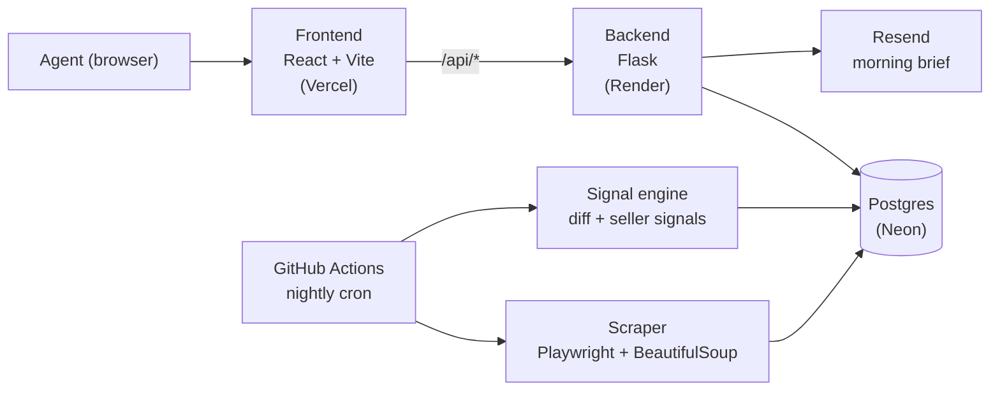

# SuburbDesk

**[suburbdesk.com](https://suburbdesk.com)** — morning seller-lead intelligence for real estate agents in Perth's western suburbs.

Every night, SuburbDesk scrapes the local listings market, detects what changed (new listings, price drops, homes under offer, sales falling through, withdrawals), scores the likely next sellers, and delivers it to agents as a morning brief and a working dashboard.

It was built from inside an agency: the workflows mirror how a listing agent actually prospects, from spotting a signal to sending the letter.

## What it does

- **Nightly market scrape** of every tracked suburb, with self-healing retries when the source site blocks or changes
- **Change detection** — run-to-run snapshots turn the raw listing stock into *transitions*: what moved overnight, not the whole list again
- **Seller signals** — withdrawn listings, fallen sales, sold-price reveals, appraisal follow-ups, and strata neighbours of a recent sale
- **Hot vendor scoring** — ranks owners most likely to sell, based on holding period and market activity
- **Prospecting pipeline** — targets per suburb with one-click personalised letters (Word)
- **Market reports** — suburb-level sales and rental reports, exportable
- **Morning brief email** — one combined daily digest, with weekly summaries
- **Multi-tenant** — each agency only sees its own suburbs; admin role for account management

## Architecture



A detailed diagram is in [`docs/ARCHITECTURE.md`](docs/ARCHITECTURE.md).

## Tech stack

| Layer | Tech |
|---|---|
| Frontend | React 18, Vite 5 — hosted on Vercel |
| Backend | Python, Flask 3, Gunicorn — hosted on Render |
| Database | Postgres (Neon) in production, SQLite locally |
| Scraping | Playwright, BeautifulSoup4, residential proxy fallback |
| Scheduling | GitHub Actions cron (nightly sales and rental scrapes) |
| Email | Resend API |
| Documents | python-docx (letters and reports) |

## Run locally

Requirements: Python 3.12 and Node.js.

```bash
cp .env.example .env      # fill in your own values
./start.sh                # macOS / Linux  — or start.ps1 / start.bat on Windows
```

The start script installs dependencies and launches the backend (Flask) and the frontend (Vite dev server) side by side. Without `USE_POSTGRES`, the backend uses a local SQLite database.

## Repository layout

```
backend/        Flask API, scraper, signal engine, email and report generation
frontend/       React + Vite single-page app
docs/           Architecture and design notes
.github/        Scheduled scrapes, keep-alive and maintenance workflows
```

## Status

Live MVP, used and iterated on from inside a Perth agency. The repository is named `MarketScraper` for historical reasons: SuburbDesk is the product.
